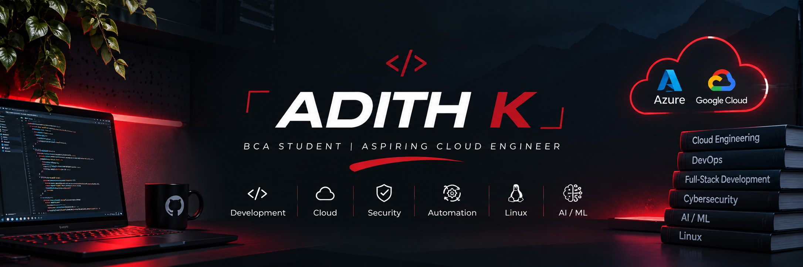

  

# Adith K

### Aspiring Cloud Engineer · BCA Student · Full-Stack Developer

Interested in building web applications and growing my skills in cloud engineering and DevOps.

---

## About Me

I'm pursuing a **Bachelor of Computer Applications (BCA)** and exploring software development through coursework and personal projects. I’m interested in full-stack development and cloud technologies, and I’m building my skills through hands-on practice.

## Current Focus

- Microsoft Azure and Google Cloud Platform
- Cloud engineering and Cloud DevOps
- Linux and Ubuntu administration
- Docker and container fundamentals
- Full-stack development and Python automation

## Technical Skills

*Tools and languages I have studied, practised, or explored; this list reflects learning, not expert-level proficiency.*

**Programming languages and web foundations**

**Frontend**

**Backend, data, and web technologies**

## Projects

### LinkShield — URL Security Analyzer

**Main development project · MERN stack**

A URL scanning application with security assessments and warning indicators. The React and Vite frontend connects to a Node.js and Express API, with MongoDB Atlas and Mongoose for data storage and dotenv for environment configuration.

_Repository is currently private; I’ll add a public link here later._

### [Student Expense Tracker](https://github.com/adith-k-git/student-expense-tracker)

A responsive browser-based expense tracker built with HTML, CSS, JavaScript, and Chart.js. It provides a dashboard, spending charts, budget tracking, and browser LocalStorage data management.

### [Task Manager](https://github.com/adith-k-git/azure-fullstack-app)

A full-stack task management app with task creation, editing, deletion, search, status filtering, priority sorting, and pagination. Built with React, Vite, Node.js, Express, and MongoDB.

### Python Downloads Folder Organizer — Planned

A planned Python automation project to sort a Windows Downloads folder into categories such as images, videos, and documents using file extensions and filesystem operations. **This project is not yet completed.**

## Tools and Technologies

## Learning Journey

I’m building a foundation through my BCA studies and project work, while exploring cloud platforms, Linux/Ubuntu, containers, and DevOps. I aim to grow into cloud engineering by applying these concepts in practical projects.

## GitHub Statistics

## Contribution Streak

## Connect With Me

- **GitHub:** [github.com/adith-k-git](https://github.com/adith-k-git)
- **LinkedIn:** [linkedin.com/in/adith-k-in](https://www.linkedin.com/in/adith-k-in/)
- **Instagram:** [@adith._adhi._](https://www.instagram.com/adith._adhi._/)
- **Portfolio:** *unavailable*
- **Email:** *unavailable*

---

Thanks for visiting my profile.

